# rpi-audio user guide

**Connect your gear. Choose where the sound goes. Check that it is working.**

Edition: 3 November 2026 · Raspberry Pi 4, pHAT DAC, OLED and rotary encoder.

[Read the illustrated HTML edition](manual/index.html). The Markdown edition below can be read directly on GitHub. The HTML embeds its images: download that one file to read it offline, or serve it with GitHub Pages.

The screen images are generated by the actual display renderer using example data. Names and channel numbers may differ on your equipment. Connection drawings are diagrams, not photographs of the assembled board.

> **Start here:** to record on a computer or Akai Force, use [Record over USB](#6-record-over-usb). To listen without a computer, use [Listen through the phat](#7-listen-through-the-phat). For local listening plus USB and network output, choose **Hub** in Outputs → Audio mode. See [Network audio](#12-network-audio).

Building the hardware yourself? Start with [Build your own device](#16-build-your-own-device): parts, wiring, assembly and first startup.

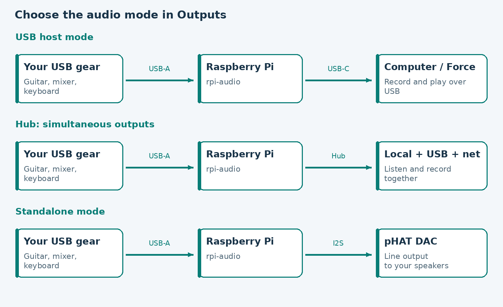

## Contents

1. [What the box does](#1-what-the-box-does)
2. [Connect the cables](#2-connect-the-cables)
3. [Use the controls](#3-use-the-controls)
4. [Read Overview](#4-read-overview)
5. [Find devices and channel assignments](#5-find-devices-and-channel-assignments)
6. [Record over USB](#6-record-over-usb)
7. [Listen through the pHAT](#7-listen-through-the-phat)
8. [Levels, mute and MIDI](#8-levels-mute-and-midi)
9. [Save and load scenes](#9-save-and-load-scenes)
10. [Display, clock and WiFi](#10-display-clock-and-wifi)
11. [If something is not working](#11-if-something-is-not-working)
12. [Network audio](#12-network-audio)
13. [Menu reference](#13-menu-reference)
14. [Administrator notes](#14-administrator-notes)
15. [Wiring and plain-language glossary](#15-wiring-and-plain-language-glossary)
16. [Build your own device](#16-build-your-own-device)

## 1. What the box does

The Pi brings audio and MIDI devices together. You might connect a guitar processor, a mixer and a keyboard, then choose where their signals go.

There are three audio modes. Choose one in **Outputs → Audio mode**; changing mode asks for confirmation because audio pauses.

| I want to… | Use this mode |
|---|---|
| Listen locally and send to USB and/or network together | **Hub: DAC + USB + net** (`hub`) |
| Use the original USB host clock and channel mapping | **USB host clock** (`host`, fresh-install default) |
| Use the local DAC without the USB audio bridge | **Standalone DAC** (`standalone`) |

**Host** means the computer or sampler using the Pi as its USB audio interface. A **source** produces a signal; a **destination** receives it. A **route** connects the two. Audio and MIDI routes are separate.

In Hub mode the pHAT provides a continuous 48 kHz engine. USB and network adapters join that engine independently. Disconnecting the USB host leaves local listening running. There are two stereo network output choices: standard RTP/PCM with an SDP description, and Ableton Link Audio. Both start disabled.

Network audio is **send-only** in this implementation. Full AES67, Dante, network input and SonoBus/AOO adapters are not implemented. See [implementation details](OUTPUTS.md) and [project research](NETWORK_RESEARCH.md).

> A WiFi connection allows administration and clock synchronization. It does not turn on network audio. Seeing “pHAT DAC” in Connections means the card is detected; it does not mean that audio is routed to it.

## 2. Connect the cables

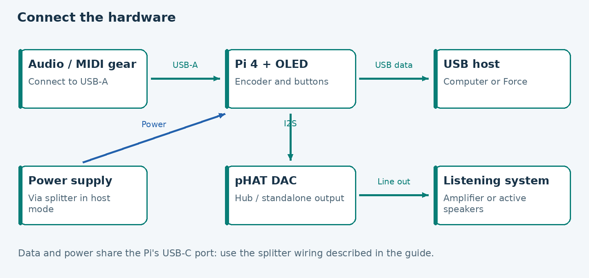

1. Connect your audio and MIDI devices to the Pi's large rectangular **USB-A** sockets.
2. Power the Pi using a suitable supply. The tested host setup uses a USB-C power/data splitter.
3. For host operation, connect the splitter's data side to the computer or Force.
4. For pHAT listening, connect its **line output** to a line input on an amplifier, mixer or powered speakers. It does not drive passive speakers directly.
5. Turn the system on and wait for Overview.

On the splitter used in this project, the supply connects to **POWER**, **DATA POWER** connects to the Pi, and **USB2 DATA** connects to the host. Other splitters may use different labels and wiring.

Turn the Pi off before moving GPIO or display wires. The wiring appendix identifies the pins used by this particular assembly.

Ethernet connects the Pi to a router or switch by cable; WiFi is wireless. Both may be connected. An IP address is not an audio destination by itself.

## 3. Use the controls

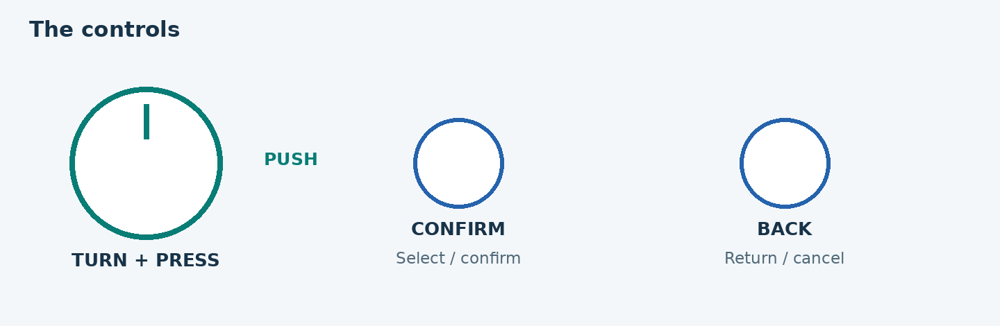

| Control | What it does |
|---|---|
| Turn the encoder | Move the selection; change the value while editing a level |
| Press the encoder, PUSH | Open or select the highlighted item |
| CONFIRM button | Confirm the highlighted item |
| BACK button | Return one screen; cancel an edit |

The service starts on **Overview**. Turn or press the encoder to open the menu. BACK from that menu returns to Overview.

If the screen was asleep or showing its screensaver, the **first touch only wakes it**. Use the next touch to navigate. Long lists scroll as you turn; their header shows the visible position. Returning keeps the previous selection.

Output names appear before their right-aligned states. Long selected names and titles start scrolling after a short pause; `..` indicates a shortened name. Main output-level edits show a large percentage above the bar. Some detail headers are shortened to Session, Machine or Profile state to keep the page position readable. Host-profile type/selection marks appear at the right of the name.

Overview also identifies the selected scene (or host profile). Load or save a scene once to establish its identity; a `*` before its name means setup changes since that load/save. The Scenes list shows `live` or `*edit` next to the active slot. Saving or reloading clears the mark, as does reverting the changed setup fields. Scene selection survives restarts and follows CLI/MIDI commands too. It does not restore engine mode or network transport settings.

Meters have a smooth fall, a short peak-hold mark and a CLIP warning retained for 1.5 seconds. Unavailable data still shows `--`. A pencil identifies editing, an hourglass means a command is running, a tick means it was stored and a cross identifies an error. Success messages disappear after two seconds; check output state and meters to confirm actual operation.

Pressing the encoder and CONFIRM always perform the same selection. Scenes offer visible **Load** and **Save here...** actions; saving asks before replacing a slot.

If CONFIRM does not respond, check the button and its wiring. The current default is GPIO 5; older notes using GPIO 23 describe an earlier wiring arrangement.

### Shut down or restart

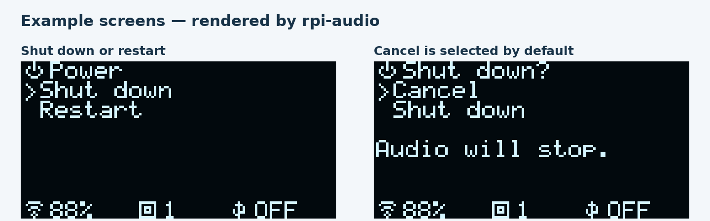

1. Open the main menu and scroll to **Power**, after Settings.
2. Choose **Shut down** or **Restart**.
3. The confirmation starts on **Cancel**. Turn to the requested action and press PUSH or CONFIRM; BACK cancels.

Both actions stop audio. Shut down lets Linux stop services and finish filesystem writes. Wait for the Pi to finish halting before unplugging; watch the Pi's activity LED rather than treating the OLED going dark as confirmation. The display service stops before all shutdown work ends. Restart boots the Pi again and keeps saved settings; leave power connected. Restart is not a factory reset.

The [official Raspberry Pi Beginner's Guide](https://magazines-static.raspberrypi.org/books/full_pdfs/000/000/026/original/000_RPi_BeginnersGuide_DIGITAL.pdf) describes waiting for the flashing green activity light to go off before disconnecting the supply after shutdown. A dark OLED by itself is not that signal.

After confirmation, extra turns and presses do not repeat the request. If it fails, the screen shows an error and BACK returns to the confirmation. Avoid unplugging a running Pi, since interrupting SD-card writes can corrupt its filesystem.

## 4. Read Overview

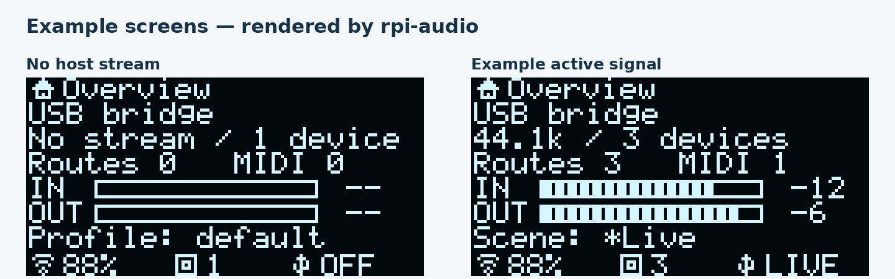

From top to bottom:

1. **Mode and USB state.** Whether the engine is using a USB host, Hub or Standalone mode.
2. **Sample rate and devices.** `44.1k` means 44,100 audio samples per second. `No stream` means there is no host audio stream at that moment.
3. **Routes and MIDI.** Active audio-route groups and MIDI routes/ports, not the number of physical cables.
4. **IN and OUT meters.** Signal peaks, updated up to five times a second.
5. **Bottom bar.** WiFi, physical-device count and USB state.

| Meter reading | Meaning |
|---|---|
| `--` | No audio measurement is available |
| `-inf` | Digital silence was actually measured |
| A number such as `-12` | A measured peak in dBFS; closer to zero means louder |
| `CLIP` | The peak reaches or exceeds digital full scale; lower the source or mix level |

With a host, **IN goes from the Pi to the host**, and **OUT comes from the host to the Pi**. In Hub and Standalone, IN covers capture bridges, including an active USB host source in Hub; OUT covers the DAC and enabled Hub output destinations. Each meter shows the highest peak in its group, not one particular stereo pair or a separate reading for every device.

The picture with signal uses example data. Seeing `--` with no active audio engine is normal. The helper reads real JACK samples only while Overview is visible and awake; it never starts an audio server to obtain a meter reading.

## 5. Find devices and channel assignments

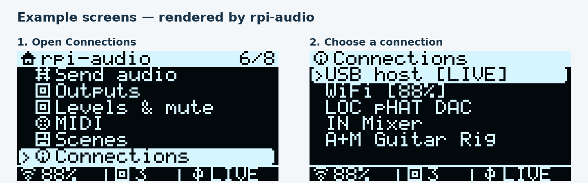

1. Press the encoder on Overview to open the menu.
2. Turn to **Connections**, then press.
3. Choose **USB host**, **WiFi**, or a device.
4. Turn to see the lower detail rows. BACK returns to the list.

WiFi details show connection state, connection name, IP address and signal. USB details distinguish a connected host from an active audio bridge.

### Bottom-bar indicators

| Indicator | Meaning |
|---|---|
| WiFi percentage | Connected; the percentage summarizes signal strength |
| WiFi `OFF` / `--` / `?` | Disabled / disconnected / could not be queried |
| Device icon and number | Physical audio/MIDI devices, including the pHAT; excludes HDMI, onboard headphones and the gadget itself |
| USB `OFF` / `IDLE` / `LIVE` | No host / connected without a stream / active audio bridge |
| USB `WAIT` / `SIL` / `SUSP` | Waiting / sending silence / host suspended |
| USB `LOC` | Standalone engine mode |

Connection changes produce short notices. They last three seconds or disappear when you use a control. The screensaver hides the fixed connection bar to protect the OLED.

### Modes and mappings

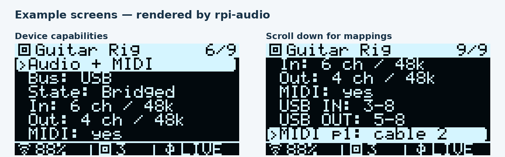

List prefixes describe what a device offers: `A+M` audio and MIDI, `I/O` audio both ways, `IN` capture only, `OUT` playback only, `MID` MIDI only, and `LOC` the local DAC.

In the original host mode an example detail screen might say:

- `USB IN: 3-8`: the host sees this device on inputs 3 through 8.
- `USB OUT: 5-8`: this device receives host outputs 5 through 8.
- `MIDI p1: cable 2`: the device's first MIDI port is assigned to virtual gadget cable 2.
- `saved`: a remembered allocation, not a claim that audio is active now.
- `unassigned`: no active or known allocation for that direction.

In Hub, the audio details show **To USB** and **From USB** routes instead; `off` means no route is selected, and `~` means waiting.

A **virtual MIDI cable is not a musical MIDI channel**. Cable 2 may still carry MIDI channels 1–16. Audio blocks are remembered so a returning device can keep its host channels. If you change a device's USB mode or channel count, check its details and the host's track inputs again.

## 6. Record over USB

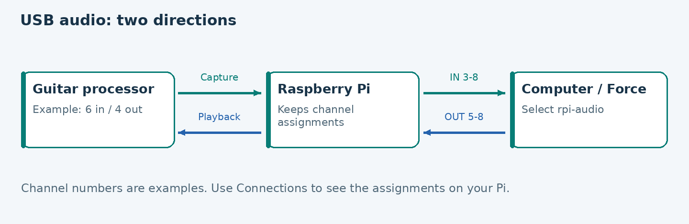

1. Choose **Hub** for combined outputs, or **USB host clock** for the original host mode.
2. Connect the USB data cable to the host.
3. Select **rpi-audio** in the host application's audio settings.
4. In **Hub**, open **Send audio → your source** and enable **USB host**. Its default destination pair follows the saved channel block; **More output pairs...** lets you choose another pair. In **host**, the saved blocks connect automatically.
5. Create or select an audio track on the host and choose those inputs.
6. Play the instrument. Check the track meter, then listen.

To return sound in Hub, open **Send audio → USB host**, choose the host output pair, then enable pHAT DAC or an attached playback device. Hub opens an attached device's playback stream when a saved audio route targets it and closes it when its last incoming route is removed. Capturing from that device to the DAC does not open its USB return. In host mode, choose the outputs shown in that device's map. Not every device receives the host's main output 1–2.

The USB interface is configured for **26 inputs and 26 outputs at 44.1 kHz, 16-bit**. Scenes and host profiles change assignments, reservations and routes, not the number of USB channels advertised to the host. They can use fewer channels without reconnecting USB. The local pHAT and each network output are stereo; 26 does not describe their channel count. A 32-channel USB interface is not implemented: the [stock gadget driver](https://github.com/raspberrypi/linux/blob/rpi-6.18.y/drivers/usb/gadget/function/f_uac2.c) supports at most 27 channels per direction, and going beyond that needs a separate module change and host tests.

For the Force, the tested sample rate is 44.1 kHz. After booting, you may need to select rpi-audio again. If it is missing after reconnecting, leave Preferences and reopen it. The add-ons that restore the Force's internal audio are optional and have separate installation instructions.

Physical tests of the original host mode are recorded for Linux and the Force. Hub USB supervision and independent rates have automated tests; physical Hub USB interoperability is not yet verified with a host in this session. Equivalent Windows/macOS hardware tests are not recorded here; check their channel visibility and actual operation before relying on them.

> Do not reboot the Pi while the host is using its audio. Stop host playback and recording before changing the engine mode.

### Save and choose a host profile

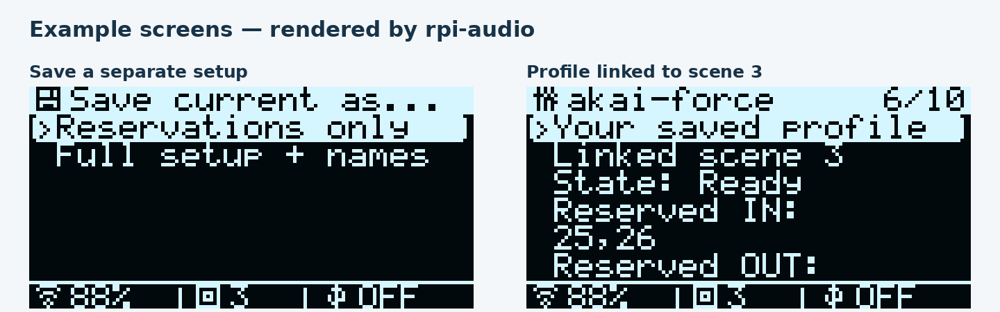

Open **Outputs → Host**. The list distinguishes **[R]** reservations only, **[S]** a complete saved setup, and **[3]** a link to scene 3 (the number varies). The star marks your selection; **default** follows the installation's configured profile or reservations.

To save what you have now:

1. Choose **Save current as...**.
2. Choose **Reservations only**, or **Full setup + names**.
3. The Pi saves it as the next free `host-1`, `host-2`, etc. You do not need to type a name on the OLED.

| Type | What happens when you choose Use this profile |
|---|---|
| Reservations only | Applies reserved USB channel numbers; keeps your current routes, levels and names |
| Full setup + names | Restores reserved channels, channel assignments, device/channel names, levels, mute, audio/MIDI routes and output switches |
| Linked scene | Applies the profile's reservations and loads the referenced scene as it is saved now |

The complete copy lives inside the profile and uses none of the eight scene slots. Overwriting or deleting a scene does not change that copy. A linked profile deliberately follows scene changes. If its scene is empty, the profile will not load and the current setup stays intact.

Choose a profile → **Use this profile** → confirm. **Details** shows its type and reserved channels. **Attach a scene...** links any saved scene; choose **Reservations only** there to remove an attached scene or saved setup. Editing a link does not immediately load it; choose Use this profile to apply it. User profiles also offer **Update from current** and **Delete profile...**, both with confirmation. Overwriting with Reservations only removes a previously saved full setup.

Factory profiles (`akai-force`, `generic`) remain in `/etc/rpi-audio/hosts.d/`. Attaching a scene to one creates your own override in `hosts.json`; the factory file stays untouched. Deleting that override reveals the factory version again. Deployments preserve your profiles in `/var/lib/rpi-audio/hosts.json`, alongside `slots.json` and `presets.json`.

Use these same commands from a terminal or the MIDI control port:

```sh
rpi-audiod host save studio reserve_in=25,26 reserve_out=1,2
rpi-audiod host save live full
rpi-audiod host preset akai-force 3
rpi-audiod host rename host-1 rehearsal
rpi-audiod host rehearsal
```

`host save studio preset=3` creates a profile with the current reservations and a scene link. `host preset NAME none` keeps only its reservations. Older `in=` / `out=` spellings still work. Saving replaces an existing user profile of that name; selecting it is a separate action. `host rename` works on your saved profiles, including your overrides, and keeps an active selection pointing at its new name. It refuses to overwrite another profile.

Local users in the **audio** group can save and rename without `sudo` after installation. A host profile never changes WiFi, engine mode, display preferences or RTP transport settings. Loading a full setup or scene can change sound immediately. In Hub, reservations update preferred USB allocations; your explicit route pairs stay as saved unless the profile loads a complete setup or scene.

## 7. Listen through the pHAT

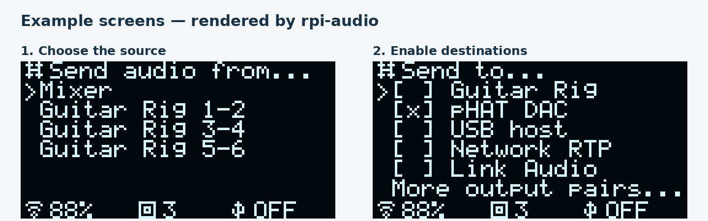

1. Open **Outputs → Audio mode** and choose **Hub** or **Standalone DAC**. Confirm the audio restart if requested. The pHAT overlay must already be installed.
2. Connect the pHAT line output to your listening equipment.
3. Open **Send audio** and choose the source, for example Mixer or Guitar Rig 1–2.
4. Press **pHAT DAC** to enable it. `[x]` means selected; `[~]` means the route is waiting.
5. Play the instrument and gradually raise the listening level.

In Hub you can enable **USB host**, **Network RTP** and **Link Audio** for the same source. Enable the network adapter in **Outputs** too. Several sources feeding the same destination are added together; reduce source levels if the mix clips.

The pHAT now has a software output level. Open **Outputs → pHAT DAC → Level**, turn to adjust, then press to apply. This changes local listening independently of USB and network feeds. **Enabled: off** cuts its routes while the local engine continues driving the other outputs.

## 8. Levels, mute and MIDI

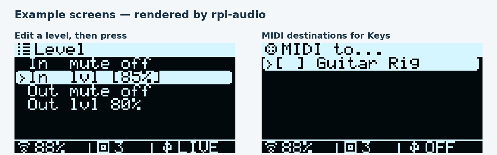

### Change a level or mute

1. Menu → **Levels & mute** → your device.
2. Select `In mute` or `Out mute` and press to toggle it.
3. For a level, select `In lvl` or `Out lvl`, then press.
4. The value appears in brackets. Turn to change it.
5. Press to commit; BACK cancels the edit.

Some devices have no usable volume control, so no level row is offered. `--` in a level value means no percentage is stored or known. This setting is different from a measured signal meter.

### Independent output levels

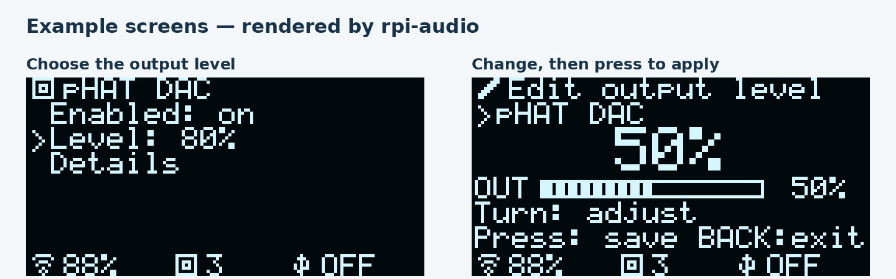

Each main destination has its own level in **Outputs**: **pHAT DAC**, **USB host**, **Network RTP**, and **Link Audio**. Choose the output → **Level**, turn, then press to apply; BACK cancels. Zero produces silence, 100% is unity, and 50% halves the signal amplitude (about −6 dB). Changes use a short ramp to avoid abrupt steps.

These controls act on the destination mix, after source mixing. Lowering the pHAT leaves USB recording and network levels unchanged. The USB-host level affects the Pi's audio sent to the host. Physical USB interfaces retain their separate hardware controls under Levels & mute. Output enable/mute and output level are separate settings.

New scenes and complete host profiles save these levels. Older scenes/profiles without an output-level field retain the current levels. A saved level is installed before the source is connected at startup. The original host mode also sends through the USB level stage; its continuous silence/keepalive behavior remains in place.

Equivalent CLI/MIDI command: `output local-dac level 50`, `output usb-host level 100`, `output network-rtp level 80`, or `output network-link level 80`.

### Route MIDI between devices

1. Menu → **MIDI**.
2. Choose the sending device.
3. Choose and enable the receiving device.
4. BACK returns to the list.

The service publishes this local MIDI port list in Hub and Standalone modes. With a host, the menu may be empty while USB MIDI pass-through still works through its assigned cables.

MIDI sends notes and commands, not recorded sound. An instrument needs an audio route as well. Start with one MIDI route and one audio route so you can check them separately.

## 9. Save and load scenes

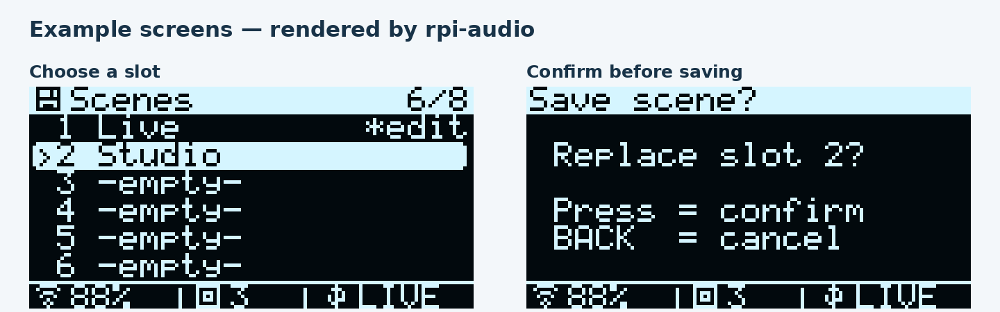

A new scene stores audio and MIDI routes, channel assignments, device/channel names, output enable flags, independent output levels, mutes and device levels. It does **not** change WiFi, engine mode, host-profile selection or RTP address/port settings. Old scenes created before name capture preserve your current names when loaded. The command-line name remains `preset` for compatibility.

### Save

1. Set up the routes, outputs and levels you want to keep.
2. Menu → **Scenes** → choose a slot from 1 to 8.
3. Choose **Save here...**.
4. Check the slot number, then press to confirm. BACK cancels.

Saving replaces an occupied slot. Choose another slot to keep it.

### Load

1. Menu → **Scenes** → choose an occupied slot → **Load**.
2. Wait for `working...` to finish and check the result.

`1 is empty` means slot 1 has nothing stored. Loading may immediately change routes and output enable flags. Both the encoder press and CONFIRM follow these same steps.

## 10. Display, clock and WiFi

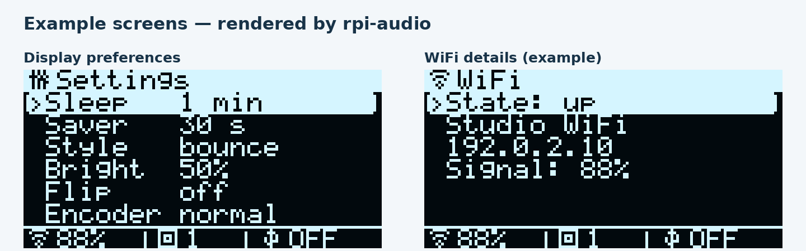

In **Settings**, each press cycles to the next value. Changes are saved:

| Option | Purpose |
|---|---|
| Sleep | When the screen goes dark without input; `never` leaves it on |
| Saver | When the screensaver starts |
| Style | Moving name, clock or rotating **status** panels |
| Bright | Display brightness |
| Flip | Rotate the image 180 degrees |
| Encoder | Reverse the direction of rotation |

The displayed clock is the Pi's system clock. Mainland Spain uses `Europe/Madrid`. Time synchronization requires a time service and network access; it does not synchronize audio sample clocks.

**Connections → WiFi** displays the current connection. It is not a WiFi setup wizard: choosing a network and entering a password are system-administration tasks. Signal strength may vary without disconnecting. If the router assigns a different IP address, use the new address to reach the Pi.

WiFi does not by itself create an Ableton audio route or a network sound card.

### Inspect the machine and every audio endpoint

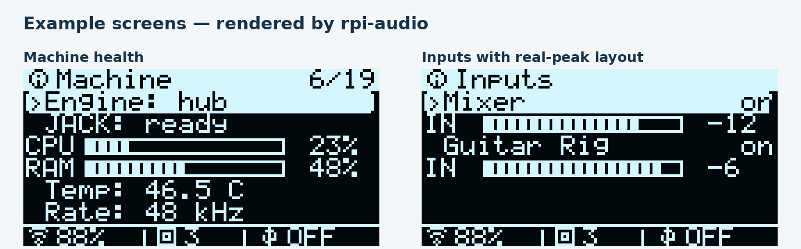

Open **Status** in the main menu:

- **Machine & buffers:** CPU and memory bars, temperature, engine state, sample rate, period, buffer frames and duration, DSP processing load, uptime and MIDI counts. Turn to read lower rows and network error counters.
- **All inputs / All outputs:** each endpoint has a state and a measured peak bar. Turn to scroll; press a device to see channels, sample rate, ALSA state, actual period/buffer sizes, delay and available frames when reported. Network endpoints show their available packet, queue, xrun and dropped-frame counters.
- **WiFi:** current connection state, network name, IP address and signal strength. The same details are available in **Connections → WiFi**.

`--` means unavailable. An unrouted output may have no measurable source. ALSA buffer fill is a sampled reading, refreshed about every two seconds. Buffer duration is capacity in milliseconds, not the complete input-to-output delay. **Session XRuns** counts notifications from the independent observer over the retained monitoring session. DSP load refers to audio processing; CPU refers to the whole Pi. A configured buffer is labelled **Config buf** when an actual ALSA read is unavailable.

### Profile readiness

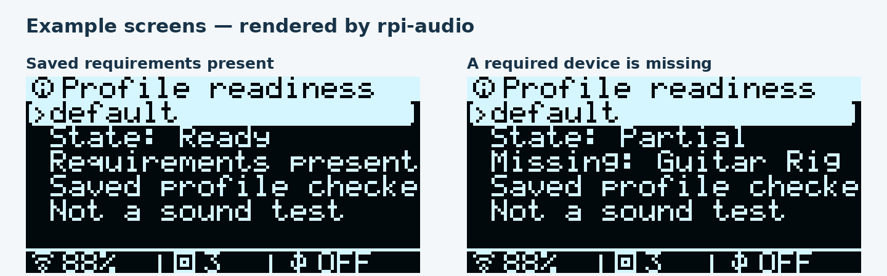

**Status → Profile readiness** shows **Ready**, **Partial**, or **Error** for the selected saved profile. Host-profile Details shows the same check for any profile. A `~` in the profile list marks Partial; `!` marks Error. Overview also shows the selected profile's readiness.

- **Ready:** the saved requirements are present. A reservations-only profile checks its reservations and has no saved device setup to check.
- **Partial:** a required device or MIDI port is absent, a device has too few channels or is waiting for bandwidth/USB allocation, the engine is waiting, or Link Audio is waiting for a receiver. Scroll for the reason and device name.
- **Error:** its linked scene is empty/missing, the profile is missing, or the stored setup is malformed.

This checks the saved setup against present resources; it does not apply the profile, compare unsaved edits, or prove that sound is audible. RTP receiver confirmation is unavailable. Intentionally muted or disabled routes do not create network-destination requirements.

### Session counters and recent events

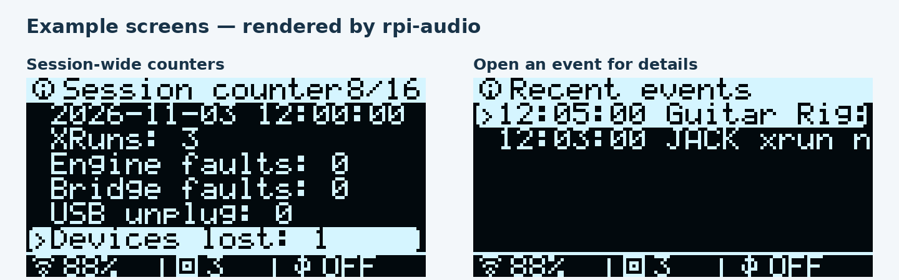

Open **Status → Session counters** for XRuns, engine/bridge faults, device and USB disconnections, local TX dropped frames, rate/buffer changes and adapter failures. The observer runs whenever JACK is active, independently of the OLED, menus and screensaver. **Recent events** lists the latest 64 records; press one for its time, detail and count. Repeated identical events close together are grouped without losing the counter total.

The session starts when this boot's monitor is first activated. It is retained across audio-mode changes and service restarts in RAM (`/run/rpi-audio/session.json`) and resets after reboot. It does not reconstruct events before monitoring started. **Observer: active** means recent telemetry is available; **waiting** means it is not. TX dropped frames are local sender/queue drops, not a measurement of packets lost elsewhere in the network. Link-send stops mean buffers stopped being delivered; they do not identify the cause by themselves.

Machine & buffers and the Status screensaver show **Session XRuns**. The passive peak helper remains responsible for signal bars; its per-process xrun counter is not used as the session total.

### Use the machine-status screensaver

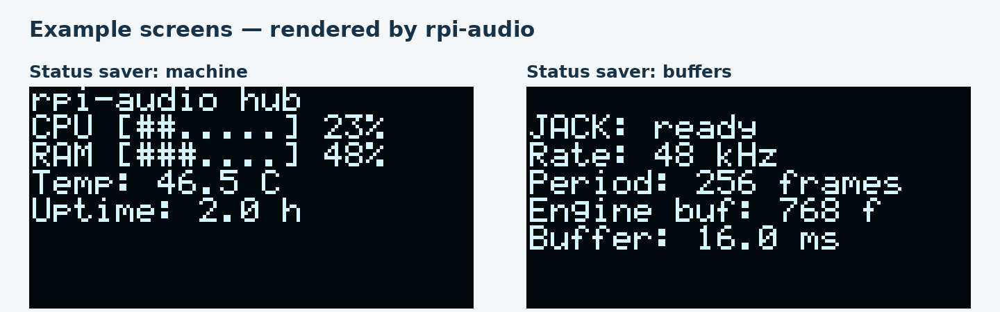

Open **Settings → Style** and press until **status** appears. After the Saver interval, the dim display rotates machine, buffer and audio-summary panels every six seconds. The picture moves horizontally and vertically. The Sleep timer still turns the screen off; choose Sleep `never` only if you want the saver to remain visible. The first touch wakes it without making a selection.

## 11. If something is not working

Check one thing at a time. Changing the cable, preset and host settings together makes it harder to tell what fixed the problem.

| What you see | First check |
|---|---|
| First press does not open a menu | A sleeping screen uses the first touch only to wake up |
| USB `OFF` | Data cable, splitter and powered host |
| USB `IDLE` | The host has selected rpi-audio and opened an audio stream |
| USB `LIVE`, wrong track input | The track uses the device's assigned input channels |
| Meter `--` | A measurement needs JACK running and Overview visible |
| Meter `-inf` with an active engine | The source is producing a signal and is not muted |
| pHAT detected, no sound | Hub or Standalone mode, an enabled route and listening equipment connected |
| `[~]` or USB-full notice | Read the device details; unplug an unused USB device and check again |
| `unassigned` or no free channels | Check allocation and device mode; that direction has no active slot |
| `CLIP` or distortion | Reduce the source or summed mix level |
| `no rpi-audiod status` | The audio service is not publishing a recent status; run the checks below |
| Clock one hour wrong | Time zone and clock synchronization |
| Echo or growing feedback | Check whether a return feeds itself; use one monitoring point |

USB bandwidth and WiFi capacity are different limits. If a problem remains, note the mode, devices, USB state, selected route and exact message. Connection and mapping screens are useful evidence.

## 12. Network audio

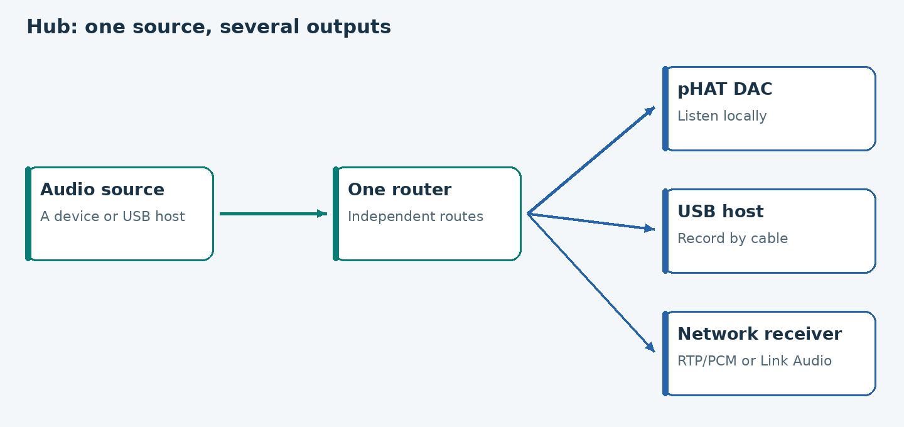

Network audio sends the selected stereo mix to another computer or compatible receiver. Start with Ethernet; WiFi can work but needs a stable network and suitable receiver buffering. Use local pHAT monitoring when playing an instrument to avoid network listening delay.

### Standard RTP/PCM

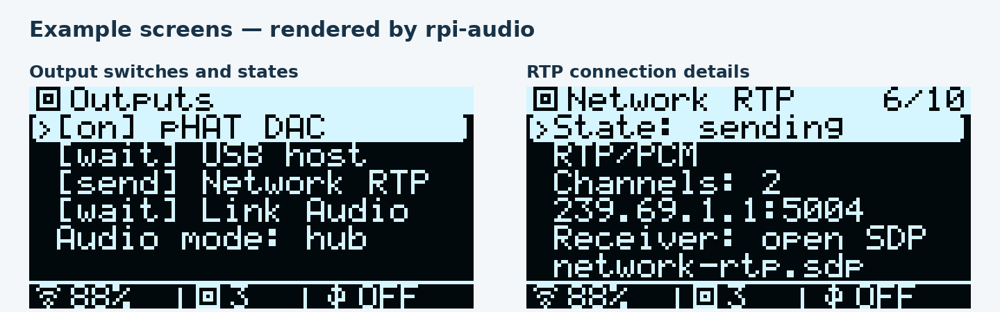

This output uses RTP/RTCP and uncompressed stereo L16 PCM. In Hub its rate is 48 kHz. The default destination is multicast `239.69.1.1`, UDP 5004, with RTCP on 5005. A receiver must support this exact format; an ordinary PC/Mac does not automatically expose it as an audio device.

1. Connect the Pi and receiver to the same network.
2. On the OLED, open **Outputs → Network RTP** and set **Enabled: on**.
3. Open **Send audio → your source** and select **Network RTP**.
4. On the other computer, browse to **`http://PI-IP:8080/`** and download the SDP file. Use the IP shown in **Connections → WiFi** or the Pi's Ethernet address. For this installation, Ethernet is currently `192.168.1.106`.
5. Open the file in an RTP/L16 receiver. With FFplay installed, for example:

```sh
ffplay -protocol_whitelist file,http,tcp,udp,rtp -i network-rtp.sdp
```

You can also try the URL directly:

```sh
ffplay -protocol_whitelist file,http,tcp,udp,rtp -i http://192.168.1.106:8080/network-rtp.sdp
```

Receiver software may require explicit permission for network protocols. If multicast is filtered, the administrator can set `[network] address` to the receiver's IPv4 address and restart the audio service. Allow the configured RTP/RTCP UDP ports. The HTTP port serves the SDP only; it does not carry the audio. Download again after changing the transport or sample rate.

`send` means the Pi is sending packets. RTP has no receiver confirmation here, so it does **not** prove someone is listening. **Outputs → Network RTP → Details** shows the address, download port and error information. The HTTP endpoint returns “unavailable” while RTP is disabled or its process is down. With `http_port = 0`, download is disabled and the administrator can copy `/run/rpi-audio/network-rtp.sdp` instead.

### Ableton Link Audio

Classic Link shares musical timing. **Link Audio** also transports sound. This implementation uses Ableton's official Link Audio SDK, pinned to Link 4.1.1. Live needs a version supporting Link Audio (Ableton documents it from Live 12.4).

1. Put the Pi and computer on the same local network.
2. Open **Outputs → Link Audio → Enabled: on**.
3. Open **Send audio → your source** and select **Link Audio**.
4. In the compatible receiving application, enable Link and its Link Audio input. Choose peer **rpi-audio**, channel **Network mix**.
5. Check the receiver's meter. The Pi reports `wait` until a receiver subscribes, then `send` as buffers are committed.

A Link peer count alone does not prove audio reception. The adapter has passed a real stereo-audio test with an independent official-SDK receiver process. A physical Ableton Live session and cross-platform latency tests remain to be performed. There is one shared stereo Link mix, not an individual mix per peer. Turning on Link Audio also participates in that Link session's musical timing.

### Compatibility and possible uses

RTP is a standard transport; sending RTP alone is **not full AES67**. This adapter does not implement PTP clock synchronization, AES67 conformance, Dante or automatic virtual ASIO/Core Audio devices. SonoBus/AOO and zita-njbridge are researched options, not installed adapters.

Useful current cases include sending a backup recording to another computer, a stereo feed to a compatible Live session, USB-computer playback through the pHAT in Hub, and local listening while transmitting the same source over the network. Network effects returns and receiving audio from another Pi need a future input adapter. A professional AES67 console requires a full compatible implementation and device-specific testing.

## 13. Menu reference

```text
Overview
  turn or press → menu; BACK from menu → Overview
Menu
  Send audio       choose source → select destinations
                   More output pairs... → individual stereo destination pairs
  Outputs          pHAT DAC / USB host / Network RTP / Link Audio
                   each: Enabled on/off / Level / Details
                   Audio mode → Hub / USB host clock / Standalone DAC
                   Host → profile → Use / Details / Attach a scene
                   Save current as... → Reservations only / Full setup + names
  Levels & mute    physical device → mute or edit available levels
  MIDI             choose sender → select receivers
  Scenes           slot → Load / Save here... → confirm saving
  Connections      USB host / WiFi / physical devices and their details
  Status           Machine & buffers / All inputs / All outputs / WiFi
                   Profile readiness / Session counters / Recent events
  Settings         display sleep, saver, brightness, rotation, encoder
```

Turn selects; encoder press and CONFIRM perform the same action. BACK returns or cancels. Returning preserves the previous selection. An engine change warns that audio will pause. Output switches are remembered, while the USB bridge keeps streaming silence if its routes are disabled so the host can retain its interface.

On first entering Hub, existing saved host mappings are converted into explicit USB routes once. You can then remove them. New devices appear as sources and destinations; select their Hub routes in Send audio. In the original host mode, automatic sticky channel routing remains available.

## 14. Administrator notes

These steps are for whoever maintains the Pi. They are not needed for everyday routing.

### Check the system

Run in a terminal on the Pi:

```sh
sudo rpi-audiod doctor
sudo rpi-audiod status
systemctl status rpi-audio-ui rpi-audiod
```

`doctor` checks the installation. `status` describes the engine and devices. Keep the actual messages when asking for help.

### Install the network adapters

On the Pi, from this checkout:

```sh
sudo ./install.sh --network
```

This builds RTP and Link Audio, downloading a pinned official SDK. It installs the SDK's license notices beside the helper. Normal updates preserve an existing helper; repeat `--network` when its C++ source changes. The standalone/Hub DAC needs the pHAT overlay already active (`--hat` sets it up; boot changes need a reboot).

### Choose the engine and outputs

The OLED is the normal way to switch mode. The equivalent commands are:

```sh
sudo rpi-audiod engine hub
sudo rpi-audiod output network-rtp on
sudo rpi-audiod output network-link on
```

The service applies these saved commands automatically. An engine change interrupts audio; stop host playback/recording first. `engine host` returns to the original host-clock mode; `engine standalone` selects local-only operation. The saved selection overrides `[engine] mode` in configuration files. Scenes do not override it.

Transport settings are in `[network]` in `/etc/rpi-audio/rpi-audio.toml` or a drop-in. Defaults are `address = "239.69.1.1"`, `port = 5004`, `ttl = 1`, `http_port = 8080`. Restart `rpi-audiod` after editing configuration. The SDP endpoint is a local-network read-only download, with no authentication or configuration controls. Keep it on your trusted network.

### Clock and WiFi

```sh
timedatectl
sudo timedatectl set-timezone Europe/Madrid
nmcli device status
nmcli radio wifi
```

These query the system except for the explicit time-zone change. Do not put passwords in screenshots, public notes or this guide.

## 15. Wiring and plain-language glossary

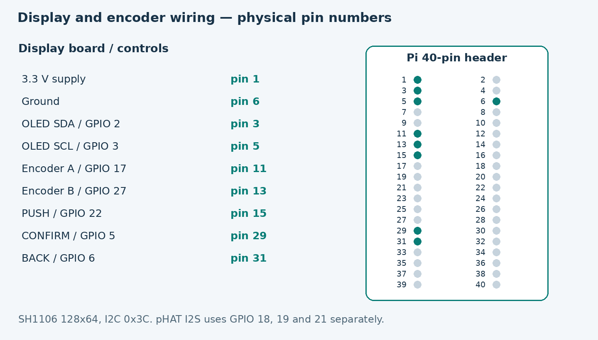

| Signal | BCM GPIO | Physical pin |
|---|---|---|
| Display-board supply | 3.3 V | 1 |
| Ground | GND | 6 |
| OLED SDA / SCL | 2 / 3 | 3 / 5 |
| Encoder A / B | 17 / 27 | 11 / 13 |
| PUSH | 22 | 15 |
| CONFIRM / BACK | 5 / 6 | 29 / 31 |

The OLED is an SH1106, 128×64, at I2C address `0x3C`. The pHAT uses I2S on GPIO 18, 19 and 21, separate from the encoder. This diagram identifies this assembly; check the labels before using a different board.

| Term | Plain meaning |
|---|---|
| Audio interface | A device that brings audio into or out of the computer or Pi |
| JACK | The engine moving and connecting audio inside the Pi |
| USB gadget | The USB interface the Pi presents to the host |
| MIDI | Notes and commands, not recorded sound |
| Latency | How long sound takes to reach its destination |
| Buffer | A small audio reserve; more margin can avoid dropouts and add delay |
| Sample rate | How many audio samples are represented per second |
| Preset | A stored routing and level configuration |

### Further reading

Menu instructions follow the code in this repository. Hardware evidence is recorded in [session notes](hw/2026-11-03-oled-wifi.md). Technical references: [display](DISPLAY.md), [standalone mode](STANDALONE.md), [MIDI](MIDI.md), [outputs implementation](OUTPUTS.md), and [network-project research](NETWORK_RESEARCH.md).

External protocol references, checked on 3 November 2026:

- [AES67 official standard](https://www.aes.org/publications/standards/preview.cfm?ID=96).
- [RTP, IETF reference](https://www.rfc-editor.org/info/rfc3550/).
- [Ableton Link Audio guide](https://help.ableton.com/hc/en-us/articles/25425913328924-Link-Audio-FAQ) and [public API](https://ableton.github.io/link/).
- [SonoBus](https://sonobus.net/) and [Zita projects](https://kokkinizita.linuxaudio.org/linuxaudio/).
- [Dante AES67 interoperability](https://support.getdante.com/hc/en-gb/articles/5508253040927-AES67-Interoperability).

References to external software do not mean its adapter is installed in rpi-audio.

## 16. Build your own device

This chapter describes the **Pi 4 + pHAT DAC + SH1106 + encoder** reference assembly. You can build the USB audio hub without the DAC or controls, then add local listening and the front panel. The complete reference build provides all three audio modes described in this guide.

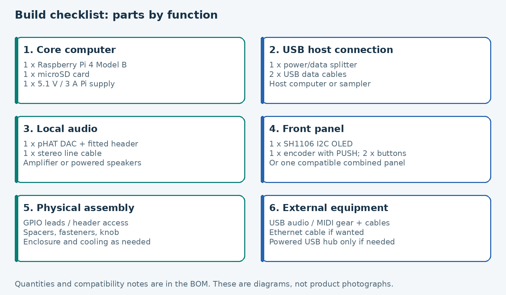

### Parts and quantities

**BOM** means *bill of materials*: the shopping and assembly checklist. Quantities below are for one device. Existing audio equipment and a computer for setup are listed separately. Links identify hardware and specifications; they do not imply current stock or that a substitute has been tested.

On a phone, swipe the tables sideways to read all columns.

| Qty | Component | Needed for | What to check |
|---|---|---|---|
| 1 | Raspberry Pi 4 Model B | Every build | Reference platform; other Pi models are not validated by this guide |
| 1 | microSD card and a reader for your setup computer | Operating system | A 32 GB card is a practical build choice, not a measured minimum requirement; flashing erases the selected card |
| 1 | Pi 4 USB-C power supply | Every build | The official 15 W supply is specified at 5.1 V / 3 A; allow separately for power-hungry peripherals |
| 1 | USB-C power/data splitter | USB host operation with a separate supply | The reference uses the 8086 USB-C/PWR Splitter; a headphone/charging adapter is not an equivalent |
| 2 | USB data cables for the splitter | USB host operation | One splitter-to-Pi cable and one splitter-to-host cable; connector ends must match your splitter/host; charge-only cables do not work |
| 1 | Pimoroni pHAT DAC | Local listening and the reference Hub clock | PCM5102A I2S stereo line output; the tested overlay is `hifiberry-dac` |
| 1 | SH1106 OLED module | Front panel | 128×64, I2C, 3.3 V-compatible power and logic; reference address `0x3C`; SSD1306 and SPI displays are not drop-in replacements |
| 1 | Mechanical quadrature encoder with a push switch and knob | Front panel | Passive A/B contacts to ground; not an encoder that drives the GPIO at 5 V |
| 2 | Normally-open momentary buttons | Front panel | CONFIRM and BACK; the encoder's own switch supplies PUSH |
| 1 set | GPIO wiring and header access | Front panel | The combined display/encoder board uses nine connections; choose leads for your connectors and leave GPIO access above the DAC |
| 1 set | Header, spacers and fasteners | Mechanical assembly | Match your DAC/header/enclosure; a stacking header or header breakout can expose the GPIO |
| 1 | Stereo line cable | Local listening | Match the DAC output and your mixer/amplifier inputs |
| As needed | USB audio/MIDI devices and their USB data cables | Audio/MIDI sources and destinations | Linux-compatible devices; these are external equipment, not parts of the Pi board |
| Optional | Ethernet cable | Setup and network audio | Wired networking makes initial setup and network-audio diagnosis easier |
| Optional | Enclosure and cooling | A permanent installation | Leave room for the DAC, wiring and connectors, ventilation and strain relief; no case CAD or verified drilling template is supplied |
| Optional | Separately powered USB hub | Peripherals that need extra power/ports | On the Pi's USB-A side; does not increase the full-speed audio bandwidth budget; test it with your devices |

The existing reference panel combines the OLED, encoder and two extra buttons on one **nine-pin board**. Its vendor/model has not been identified in the project notes. If you already have that board, do not buy the separate controls again. If buying new parts, the separate components above describe the required electrical interface; their particular combination has not been physically validated here.

Pimoroni currently lists the original pHAT DAC as retired. A PCM5102A board explicitly compatible with the `hifiberry-dac` overlay is a possible substitute, but its power, I2S pin labels, hardware straps and mechanical fit must be checked against its manufacturer's instructions. This project has tested the pHAT, not every PCM5102A board. Changing DAC type may also require changing the ALSA card setting; the label “pHAT DAC” in the interface does not identify arbitrary hardware.

Manufacturer references: [Pi power supply specifications](https://www.raspberrypi.com/products/type-c-power-supply/), [8086 splitters](https://www.8086.net/products/), [pHAT DAC product status](https://shop.pimoroni.com/products/phat-dac), and [Raspberry Pi GPIO reference](https://www.raspberrypi.com/documentation/computers/raspberry-pi.html#40-pin-gpio-header). References checked on 3 November 2026.

### Tools and preparation

Have a small screwdriver, insulated leads and a multimeter for continuity checks. A soldering iron is needed if the DAC header or panel connections are not already fitted. Solder with the boards disconnected from all power and USB cables. A pre-soldered DAC plus a suitable GPIO breakout can avoid soldering directly to the Pi.

Prepare a computer with a microSD reader and network access. Use [Raspberry Pi Imager](https://www.raspberrypi.com/software/) to write **Raspberry Pi OS Lite, 64-bit** to the card. The recorded system uses Debian 13/trixie; there is no published minimum RAM or stress-tested compatibility matrix for other operating systems. In Imager, set your own user, password or SSH key, hostname, WiFi country/network if needed, and enable SSH. Never copy another builder's credentials or assume that this example device's IP address belongs to yours. The [official setup guide](https://www.raspberrypi.com/documentation/computers/getting-started.html) explains these steps.

### Assemble with the power disconnected

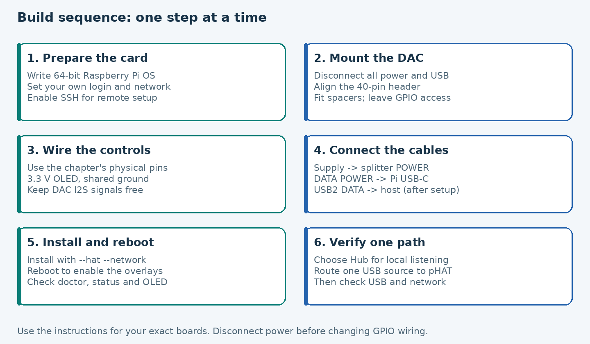

1. Fit the Pi in a suitable non-conductive support or enclosure base. Insert the prepared microSD card.
2. Fit the DAC header if necessary, then align the DAC with the Pi's 40-pin header using the pin-1 markings. Do not shift it by a row or pin. Secure it with spacers so its underside cannot touch other metalwork.
3. Leave access for the panel leads using a suitable stacking header or breakout. The reference assembly has wires soldered to the DAC's upper header pads; that is one assembly method, not a requirement to modify every DAC.
4. Connect the OLED and controls using the table below. Check **physical pin numbers** against the board orientation; **BCM GPIO numbers** name signals and are not header positions.
5. Check for shorts between supply and ground, loose strands and reversed connectors before applying power. Fix the wiring so turning the knob or moving a cable cannot pull a contact free.

| Panel signal | BCM GPIO or supply | Physical header pin |
|---|---|---|
| VCC | 3.3 V | 1 |
| GND / switch common | Ground | 6 |
| OLED SDA | GPIO 2 | 3 |
| OLED SCL | GPIO 3 | 5 |
| Encoder A / TRA | GPIO 17 | 11 |
| Encoder B / TRB | GPIO 27 | 13 |
| Encoder PUSH switch | GPIO 22 | 15 |
| CONFIRM switch | GPIO 5 | 29 |
| BACK switch | GPIO 6 | 31 |

The switches connect their signal to ground when pressed; the software requests pull-ups. With separate components, share ground between the OLED, encoder and buttons. A bare mechanical encoder does not need a VCC wire; a module may have one, in which case check its circuitry. The display/control wiring uses **3.3 V**, never a 5 V pull-up on the GPIO. Use module labels rather than copying the position of pins on another OLED: their order varies.

The DAC occupies I2S GPIO **18, 19 and 21** (physical **12, 35 and 40**) and uses its header for power/ground. Do not reuse those signals for buttons. The table above describes panel wiring, not the wiring of a bare DAC chip. The [wiring diagram in chapter 15](#15-wiring-and-plain-language-glossary) and [display reference](DISPLAY.md#wiring-a-9-pin-encoder-board-with-an-i2c-oled-and-a-pimoroni-phat-dac) provide context. The current CONFIRM/BACK defaults are GPIO 5/6; older lab notes using GPIO 23/24 describe an earlier arrangement.

### Connect power, data and listening equipment

For the reference 8086 splitter, connect the supply to **POWER**, **DATA POWER** to the Pi's USB-C port, and **USB2 DATA** to the host. Follow the labels and instructions of your exact splitter revision: an arbitrary Y cable can join power sources and is not interchangeable. The host connection carries USB 2 data, while the Pi receives power from the separate supply. Do not rely on the host to power the full Pi and its peripherals.

For local-only operation without a host, the supply can connect directly to the Pi's USB-C port. Connect audio/MIDI equipment to the Pi's **USB-A** ports. The reference host data path is direct to the host; a powered peripheral hub, if needed, belongs on the USB-A equipment side.

Connect the pHAT line output to a mixer, amplifier or powered speakers. It is not a microphone preamp, headphone amplifier or speaker amplifier. Start with the listening system's volume low. The Pi's own headphone socket is not the pHAT output.

### Install the software

On the first boot, leave the USB host disconnected. Reach the Pi using SSH to your chosen hostname or router-assigned address, or use a local keyboard and display. Run these commands **on the Pi**:

```sh
sudo apt update
sudo apt install -y git
git clone https://github.com/trak3r-os/mpc-rpi4-audioface.git
cd mpc-rpi4-audioface
sudo ./install.sh --hat --network
```

That command installs the OLED/GPIO support, enables I2C and the pHAT overlay, builds the main output-volume helper, and builds RTP/Link Audio using a pinned official SDK. The network build needs Internet access and may take several minutes. For the same physical build without network audio, use `sudo ./install.sh --hat` instead. For a USB-only build without the display and DAC, use `sudo ./install.sh`; do not select Hub/Standalone until a suitable local audio device is configured.

If your host is an Akai Force, append `--host akai-force` to the chosen install command. The generic configuration is for other hosts. Neither option installs optional add-ons on the host itself. The USB gadget remains **26×26**; scene changes do not alter its descriptors.

The installer reports boot changes. For a fresh build, reboot once to activate them:

```sh
sudo reboot
```

Reconnect to your Pi and check:

```sh
rpi-audiod doctor
rpi-audiod status
systemctl status rpi-audiod rpi-audio-ui --no-pager
aplay -l
```

Expected results: both services are active, the OLED shows Overview, and ALSA lists the pHAT as `sndrpihifiberry`. In the fresh-install **host** mode, audio waits for a USB host stream; that alone is not a failure. For local listening or combined outputs, select **Outputs → Audio mode → Hub** and confirm. Then Status should show the local engine at 48 kHz with the DAC available. Network outputs remain disabled until you enable them; a detected device still needs an audio route.

### Check the build one step at a time

| Check | What success looks like | If it fails |
|---|---|---|
| Power | Pi boots and stays accessible | Inspect supply, splitter orientation and cables; `rpi-audiod doctor` reports power flags |
| OLED | Overview appears | Check SH1106/I2C model, 3.3 V, ground, SDA/SCL and `0x3C`; details in DISPLAY.md |
| Encoder | Each detent moves the selection | Check A/B/common; reverse direction in Settings → Encoder if necessary |
| Buttons | PUSH/CONFIRM select; BACK returns | Wake the screen first; check GPIO 22/5/6 and ground; avoid historical 23/24 wiring |
| DAC | `aplay -l` lists the card; Hub starts its engine | Check the header/overlay and reboot after enabling it |
| Local sound | A USB source routed to pHAT is heard | Check source mode, Send audio, output enabled/level, cable and the listening system |
| USB host | Host lists rpi-audio and receives a routed source | Check the data path, host interface selection and correct track channels |
| Network | Receiver gets the chosen stereo mix | Enable RTP or Link Audio, route a source, then follow chapter 12; WiFi alone is not an audio stream |

For an isolated front-panel diagnostic, stop **only** the UI service, run one tool from the checkout, then start the UI again. Stop host recording before maintenance that changes audio:

```sh
sudo systemctl stop rpi-audio-ui
sudo python3 tools/oled-test.py --hold 5
sudo python3 tools/panel-test.py --seconds 20
sudo systemctl start rpi-audio-ui
```

The OLED test draws a pattern; the panel test prints turns and button events. They are useful for wiring diagnosis, not proof of audio quality. Once the checks pass, secure the wiring and close the enclosure without pinching cables. This is a documented module-based reference build: a custom PCB, complete enclosure design and identified vendor for the original combined panel are not included.
